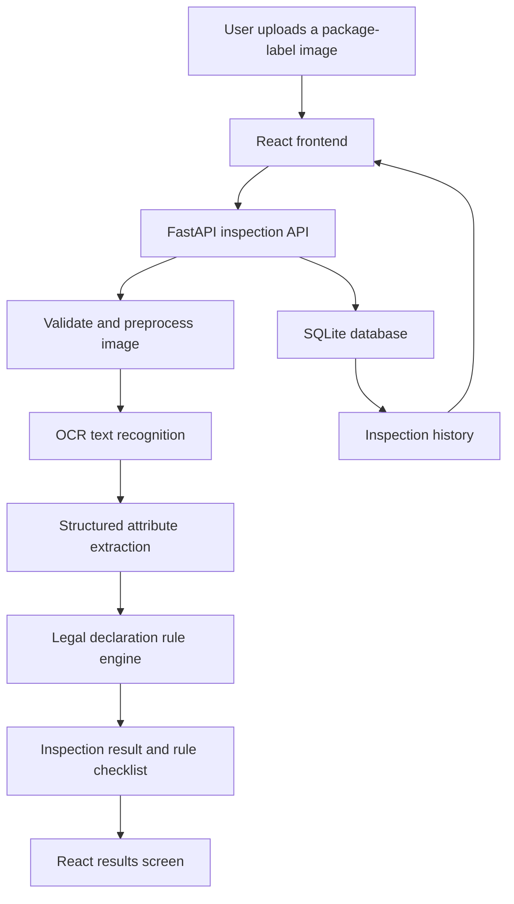

# Packaged Commodities Compliance Inspector

A Smart India Hackathon student prototype that helps inspect packaged-commodity labels against relevant declarations in the Legal Metrology (Packaged Commodities) Rules, 2011. It combines image preprocessing, OCR, structured attribute extraction, and rule-based checks to produce an inspection report.

> **Status and scope:** This is a prototype and decision-support aid, not a legally binding compliance determination. OCR and extraction can be wrong, and applicable law or interpretations can change. A qualified reviewer should verify results against current official requirements.

## At a Glance

- **Frontend:** React 18 + Vite + Tailwind CSS
- **Backend:** Python + FastAPI
- **OCR and image processing:** RapidOCR ONNX Runtime, OpenCV, Pillow, NumPy
- **Structured extraction:** Gemini-backed parser (requires a Gemini API key for the relevant extraction flow)
- **Data persistence:** SQLAlchemy + SQLite
- **Tests:** pytest and HTTPX
- **API documentation:** FastAPI Swagger UI at `/docs`

## How It Works



1. The user uploads a package-label image in the web interface.
2. The API validates the upload and prepares the image for OCR.
3. OCR detects visible text; extraction logic organizes relevant declarations into structured fields.
4. The rule engine evaluates supported declaration checks using the extracted data.
5. The frontend displays the inspection result, extracted attributes, and rule-level findings.
6. The backend stores supported inspection-history records in SQLite.

## Main Components

| Path | Responsibility |
| --- | --- |
| `backend/main.py` | Creates the FastAPI app, mounts uploads, configures CORS, and registers routers |
| `backend/app/api/` | API routes for health, upload, OCR, extraction, compliance, history, and inspection |
| `backend/app/ocr/` | OCR service, image preprocessing, and script detection |
| `backend/app/extractor/` | Structured attribute extraction |
| `backend/app/rules/` | Declaration rules, rule models, and evaluation engine |
| `backend/app/inspection/` | Inspection processing, evidence fusion, and result aggregation |
| `backend/app/db/` | SQLAlchemy models, sessions, and database operations |
| `backend/tests/` | Automated and manual verification tests |
| `frontend/src/components/` | React UI components for upload, results, history, and navigation |
| `frontend/src/services/api.js` | Frontend API calls |
| `samples/` | Sample label image for development and demos |

## Tech Stack

### Backend
- Python
- FastAPI and Uvicorn
- RapidOCR ONNX Runtime
- OpenCV, Pillow, and NumPy
- SQLAlchemy with SQLite
- Pydantic and python-dotenv
- pytest and HTTPX

### Frontend
- React 18
- Vite
- Tailwind CSS
- Lucide React

## Run Locally

Prerequisites: Python and Node.js/npm installed.

### 1. Configure and start the backend

From the repository root:

```bash
cd backend
python -m venv .venv
```

Activate the virtual environment:

- **Windows PowerShell:** `.venv\\Scripts\\Activate.ps1`
- **Windows Command Prompt:** `.venv\\Scripts\\activate.bat`
- **macOS/Linux:** `source .venv/bin/activate`

Install dependencies:

```bash
python -m pip install -r requirements.txt
```

Create a local environment file by copying `.env.example` to `.env`, then add a valid `GEMINI_API_KEY` if you intend to use the Gemini-backed extraction flow. Keep the real `.env` file private and never commit it.

Start the API from inside the `backend` directory:

```bash
uvicorn main:app --reload
```

Useful local endpoints:

- API root: http://127.0.0.1:8000/
- Interactive API docs: http://127.0.0.1:8000/docs
- Health check: http://127.0.0.1:8000/api/health

### 2. Configure and start the frontend

Open a second terminal at the repository root:

```bash
cd frontend
npm install
```

Create a local `.env` file from `.env.example` if needed. For local development, the example values point to the backend at `http://localhost:8000`.

Start Vite:

```bash
npm run dev
```

Open the local URL printed by Vite in your browser. Keep the backend terminal running while testing uploads and history.

## Run Tests

From the repository root:

```bash
cd backend
python -m pytest
```

This command describes how to run the test suite; run it locally to confirm the current result in your environment.

## Security and Responsible Use

- Never commit real API keys, credentials, populated `.env` files, or private tokens.
- Validate file types and sizes; treat uploaded images and OCR text as untrusted input.
- The current backend CORS configuration allows all origins. Restrict `allow_origins` to the deployed frontend domain before production use.
- Do not expose the uploads directory or inspection history beyond the intended access model in a production deployment.
- Verify statutory rules and sources against current official documents.
- Treat automated findings as review assistance, not a legal opinion or final enforcement decision.

## Demo Walkthrough

1. Start the backend and frontend using the instructions above.
2. Open the app and upload a clear package-label image (the repository includes `samples/sample_product_label.png`).
3. Review the OCR/extracted declarations and the rule-by-rule result.
4. Open inspection history and inspect a saved result.
5. During a presentation, explain how image quality and extraction errors can affect the outcome.

## Roadmap

- Add verified screenshots and a short demo video.
- Document rule coverage with references to the applicable official clauses.
- Add representative test cases for blurry, rotated, multilingual, incomplete, and unsupported labels.
- Restrict CORS and review upload, history, and API security before any public deployment.
- Add a clear provenance trail for extracted attributes and rule findings.

---

Built as a student hackathon prototype for exploring automated packaged-commodity label inspection.
